<p align="center">
  
</p>

<p align="center">
  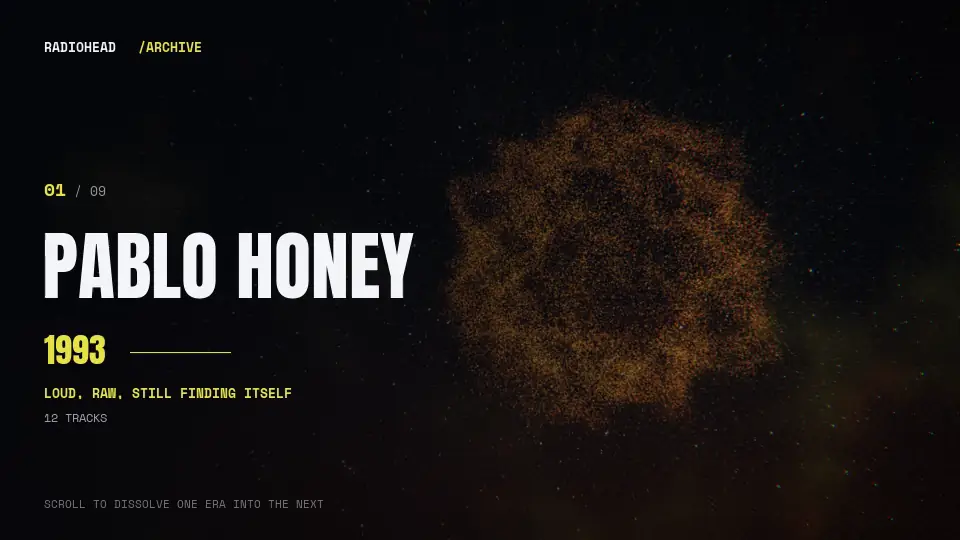
</p>

<p align="center">
  <b>Nine albums. One cloud of light. Scroll, and it becomes the next record.</b><br>
  <sub>Every Radiohead studio album, from Pablo Honey to A Moon Shaped Pool, reimagined as a living shape with a sound of its own.</sub>
</p>

<p align="center">
  <sub><a href="#01--the-idea">THE IDEA</a> &nbsp;·&nbsp; <a href="#02--the-nine">THE NINE</a> &nbsp;·&nbsp; <a href="#03--how-to-move-through-it">HOW TO MOVE THROUGH IT</a> &nbsp;·&nbsp; <a href="#04--run-it">RUN IT</a> &nbsp;·&nbsp; <a href="#05--under-the-hood">UNDER THE HOOD</a> &nbsp;·&nbsp; <a href="#06--credits-and-license">CREDITS</a></sub>
</p>

<br>

## 01 · The idea

Most music archives are lists. This one is a place.

Ninety thousand points of light hang in the dark. On each album they hold a new form: a scorched sphere for the debut, a double helix for The Bends, a motorway at night for OK Computer, a frozen ridge for Kid A. Scroll, and the shape comes apart and drifts into the next one, so you travel through the band's history the way you would listen to it, one era turning into another.

Each record also gets its own colours, its own short mood note, and its own soundscape, generated live in your browser as you arrive.

<br>

## 02 · The nine

<table>
  <tr>
    <td width="33%" valign="top">
      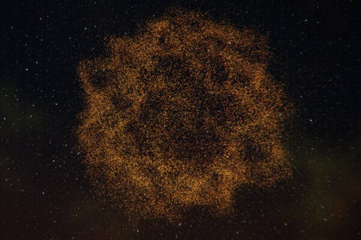<br>
      <sub><b>01 &nbsp; PABLO HONEY</b> &nbsp; 1993</sub><br>
      <sub>Loud, raw, still finding itself.<br>A noisy sphere, overdriven and unsure.</sub>
    </td>
    <td width="33%" valign="top">
      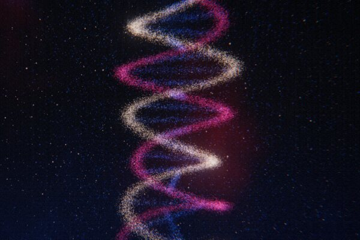<br>
      <sub><b>02 &nbsp; THE BENDS</b> &nbsp; 1995</sub><br>
      <sub>Big guitars, bare nerves.<br>A double helix, a pulse under pressure.</sub>
    </td>
    <td width="33%" valign="top">
      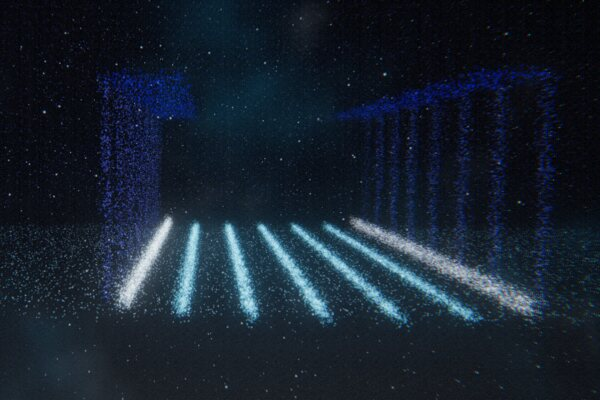<br>
      <sub><b>03 &nbsp; OK COMPUTER</b> &nbsp; 1997</sub><br>
      <sub>Anxiety at the speed of the nineties.<br>A wireframe motorway to a vanishing point.</sub>
    </td>
  </tr>
  <tr>
    <td width="33%" valign="top">
      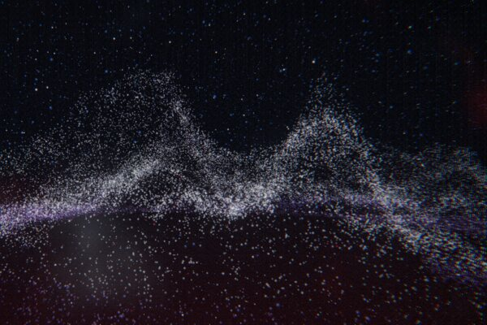<br>
      <sub><b>04 &nbsp; KID A</b> &nbsp; 2000</sub><br>
      <sub>Cold, electronic, deliberately different.<br>A faceted field of ice.</sub>
    </td>
    <td width="33%" valign="top">
      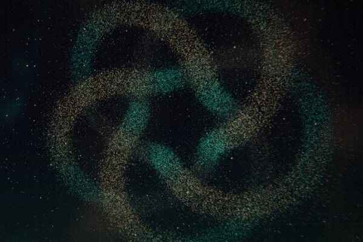<br>
      <sub><b>05 &nbsp; AMNESIAC</b> &nbsp; 2001</sub><br>
      <sub>Kid A's darker, stranger twin.<br>A knot that keeps returning to itself.</sub>
    </td>
    <td width="33%" valign="top">
      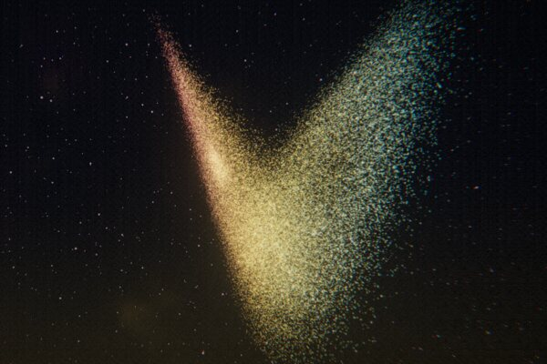<br>
      <sub><b>06 &nbsp; HAIL TO THE THIEF</b> &nbsp; 2003</sub><br>
      <sub>Fast, restless, politically jumpy.<br>Chaos, mapped as a strange attractor.</sub>
    </td>
  </tr>
  <tr>
    <td width="33%" valign="top">
      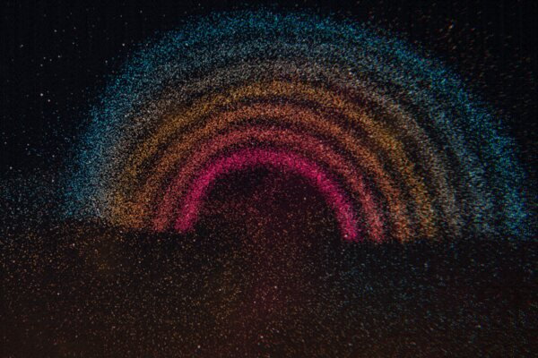<br>
      <sub><b>07 &nbsp; IN RAINBOWS</b> &nbsp; 2007</sub><br>
      <sub>Warm, rhythmic, full of colour.<br>A full spectrum of arcs.</sub>
    </td>
    <td width="33%" valign="top">
      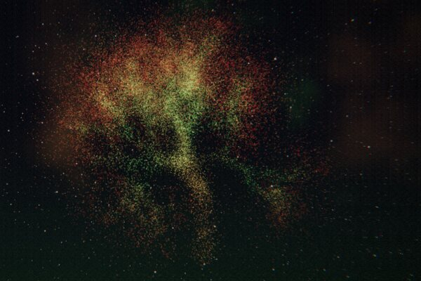<br>
      <sub><b>08 &nbsp; THE KING OF LIMBS</b> &nbsp; 2011</sub><br>
      <sub>Short, looped, organic.<br>A tree grown from repeating patterns.</sub>
    </td>
    <td width="33%" valign="top">
      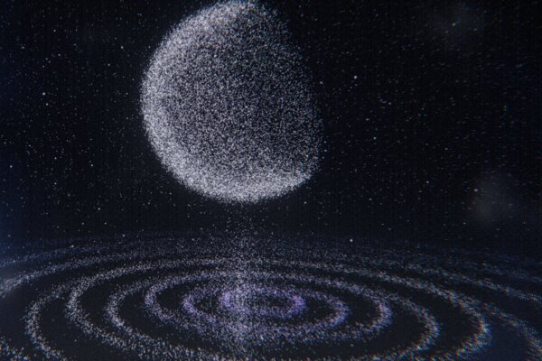<br>
      <sub><b>09 &nbsp; A MOON SHAPED POOL</b> &nbsp; 2016</sub><br>
      <sub>Quiet, deep, orchestral.<br>A moon over still, rippling water.</sub>
    </td>
  </tr>
</table>

<sub>Every image above is a real, unedited frame from the site.</sub>

<br>

## 03 · How to move through it

| To | Do this |
| --- | --- |
| **Travel between albums** | Scroll, swipe, or use the arrow keys |
| **Jump straight to one** | Press `1` to `9`, or pick it from the side rail |
| **Disturb the light** | Move your pointer through the cloud |
| **Send a shockwave** | Click anywhere, or click a track title to hear a note |
| **Listen properly** | Press Listen Here to play the album in an in-site player |
| **Let the music lead** | Switch Calm to Reactive, and the cloud pulses with the sound |
| **Read deeper** | Timeline, Band and Stories, each with photographs from the era |

<br>

## 04 · Run it

```bash
npm install
npm run dev
```

Then open `http://localhost:5173`. Headphones recommended.

`npm run build` produces a static site in `dist/` that runs anywhere, including GitHub Pages and Vercel, both already configured.

<br>

## 05 · Under the hood

<details>
<summary><b>How the light works</b></summary>
<br>

A single GPU particle cloud of up to 120,000 points is shared by every album. Each album's shape is generated procedurally at load and uploaded as a static buffer, and the vertex shader blends between neighbouring shapes using the scroll position, so the morph is fully scrubbable in both directions. Flow-field noise, pointer repulsion and click shockwaves are applied in the same pass.

The frame is finished with bloom, chromatic aberration, a scroll-speed glitch, film grain, scanlines and a vignette. Quality adapts automatically to hold a steady frame rate, phones get a lighter budget, reduced-motion preferences are respected, and a lite mode takes over if WebGL is unavailable.
</details>

<details>
<summary><b>How the sound works</b></summary>
<br>

There are no recordings in this project. Each album has its own patch built entirely from the Web Audio API: step sequencers, FM synthesis, filtered noise and a generated reverb, crossfaded as you move between eras. In Reactive mode an analyser feeds the bass, mids and highs back into the visuals.
</details>

<details>
<summary><b>Project layout</b></summary>
<br>

```
index.html              page shell and interface markup
style.css               all styling
src/
  main.js               boot, input and render loop
  audio.js              generative soundscapes
  scene/                particle stage, shaders, the nine shape generators
  data/                 albums, timeline, band, stories, photo credits
  ui/                   main screen, sheets and player
  assets/pics/          locally stored photographs
docs/readme/            images used in this README
```

Built with Three.js and Vite. No framework.
</details>

<br>

## 06 · Credits and license

Photographs in Timeline, Band and Stories come from Wikimedia Commons under free licences. Hover any image on the site for its author and source, or see `src/data/pics.js`.

This is an unofficial fan project with no affiliation to Radiohead. Band and album names belong to their owners and are used only to identify the music.

Copyright (c) 2026 Kalyan. All rights reserved. The code and writing in this repository may not be copied, modified or redistributed without written permission. Third-party photographs and dependencies keep their own licences. See [LICENSE](LICENSE).

<br>

<p align="center"><sub>Made by a fan, for anyone who has ever lost an afternoon to these records.</sub></p>
